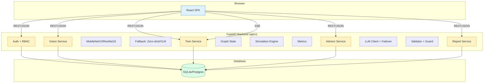

# Architecture Diagram



---

## Data Flow

```
Scan Flow:
1. User captures/upload image (CameraCapture)
2. Client downscales to max 1024px, JPEG 0.85
3. POST /api/v1/scan (multipart)
4. Server: validate → strip EXIF → resize → infer
5. If confidence < 0.60: fallback to vision LLM
6. If still unsure: return "unsure" with cautious guidance
7. Return: class, subtype, confidence, top3, guidance
8. Save scan event → ingest into twin
9. SSE broadcasts: scan.created, metrics.updated

Twin Flow:
1. GET /api/v1/twin → graph + metrics
2. SSE /api/v1/twin/stream → live updates
3. POST /api/v1/simulate → baseline vs scenario
4. Metrics computed from engine state

Advisor Flow:
1. POST /api/v1/advice → structured JSON
2. Input: metrics, contamination causes, hotspots, deltas, user stats, knowledge
3. LLM with strict system prompt + validator
4. Validator checks all numbers trace to input
5. On failure: template fallback
6. POST /api/v1/chat → streaming chat
```